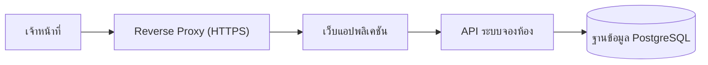

# วิธีใช้
อ่านเพื่อจับสำนวนแบบเอกสารออกแบบสถาปัตยกรรมและซอฟต์แวร์ (SDD) ของผู้รับจ้างโครงการภาครัฐ แล้วเขียนด้วยชื่อ
หน้าจอ ตาราง และ API ตามข้อเท็จจริงของโครงการนี้ ตัวอย่างเป็นระบบสมมติ "ระบบจองห้องประชุม"
ภาพหน้าจอใช้บรรทัด [ภาพหน้าจอ: …] แทนจนกว่าจะมีภาพจริง

## ตัวอย่างที่ 1
## 2.3 บันทึกการตัดสินใจเชิงสถาปัตยกรรม (Architecture Decision Records)
| หัวข้อ | รายละเอียด |
|---|---|
| รหัส ADR | ADR-01 |
| หัวข้อการตัดสินใจ | การเลือกฐานข้อมูลเชิงสัมพันธ์ PostgreSQL สำหรับข้อมูลการจอง |
| สถานะ | อนุมัติ (Accepted) |
| บริบท (Context) | ข้อมูลการจองต้องป้องกันการจองเวลาซ้อนกันได้อย่างแน่นอน และต้องรายงานสถิติการใช้ห้องรายเดือน |
| ทางเลือกที่พิจารณา | 1) PostgreSQL / 2) MySQL / 3) ฐานข้อมูลแบบ Document |
| การตัดสินใจ | เลือกทางเลือกที่ 1 (PostgreSQL) |
| เหตุผลประกอบ | รองรับ Exclusion Constraint ป้องกันช่วงเวลาซ้อนกันที่ระดับฐานข้อมูล และเป็นซอฟต์แวร์ที่มีสัญญาอนุญาตถูกต้อง |
| ผลที่ตามมา (Consequences) | ทีมพัฒนาต้องออกแบบ Migration ด้วยเครื่องมือของ PostgreSQL |
| ข้อกำหนด/ข้อจำกัดที่เกี่ยวข้อง | FR-BK-02, DC-01 |

สิ่งที่ทำให้อ่านเป็นงานคนเขียน: บริบทบอกปัญหาจริงของระบบนี้ ทางเลือกมีเลขกำกับ และอ้างรหัสข้อกำหนดที่เกี่ยวข้อง

## ตัวอย่างที่ 2
## 3.1 ภาพรวมสถาปัตยกรรม (Architecture Overview)
ส่วนประกอบของระบบเชื่อมต่อกันตามลำดับชั้น ดังภาพต่อไปนี้

ภาพ: ภาพรวมสถาปัตยกรรมของระบบ

## 3.2 มุมมองเชิงตรรกะ (Logical View)
แสดงการแบ่งชั้นและองค์ประกอบหลักของระบบ พร้อมความรับผิดชอบของแต่ละชั้น
| ชั้น (Layer) | ความรับผิดชอบ | เทคโนโลยีที่ใช้ |
|---|---|---|
| Presentation Layer | แสดงหน้าจอค้นหาและจองห้องแบบ Responsive | เว็บแอปพลิเคชัน (เสนอ) |
| Application Layer | ตรวจสอบสิทธิ์ ตรวจเวลาซ้อน และบันทึกการจอง | REST API |
| Data Layer | จัดเก็บข้อมูลห้อง การจอง และ Audit Log | PostgreSQL |

## ตัวอย่างที่ 3
### M01: ระบบจองห้อง (Booking Module)
| หัวข้อ | รายละเอียด |
|---|---|
| วัตถุประสงค์ | ให้เจ้าหน้าที่ค้นหาและจองห้องประชุมได้ด้วยตนเอง ตามข้อ 4.2.1 ของ TOR |
| หน้าที่หลัก | ค้นหาห้องว่าง บันทึกการจอง ยกเลิกการจอง และส่งคำขอให้ผู้อนุมัติเมื่อเป็นห้องขนาดใหญ่ |
| FR ที่รองรับ | FR-BK-01, FR-BK-02, FR-BK-03 |
| ข้อมูลที่ใช้ | TBL-01 rooms, TBL-02 bookings |
| ความมั่นคงปลอดภัย | ผู้ใช้แก้ไขหรือยกเลิกได้เฉพาะการจองของตนเอง ทุกการเปลี่ยนแปลงบันทึกลง Audit Log |

## ตัวอย่างที่ 4
### SCR-02 จองห้องประชุม
[ภาพหน้าจอ: จองห้องประชุม]
ภาพ: หน้าจอจองห้องประชุม
| หัวข้อ | รายละเอียด |
|---|---|
| รหัสหน้าจอ | SCR-02 |
| ชื่อหน้าจอ | จองห้องประชุม |
| โมดูล | M01 ระบบจองห้อง |
| วัตถุประสงค์ | บันทึกการจองห้องพร้อมเวลาและหัวข้อการประชุม |
| กลุ่มผู้ใช้ | เจ้าหน้าที่ (U-01) |
| องค์ประกอบหลัก (UI Components) | ช่องห้องประชุม (แก้ไขไม่ได้), ช่องเวลาเริ่ม, ช่องเวลาสิ้นสุด, ช่องหัวข้อ, ปุ่มบันทึก, ปุ่มยกเลิก |
| ข้อมูลที่แสดง | ชื่อห้อง ความจุ และการจองอื่นของห้องในวันเดียวกัน |
| การกระทำที่รองรับ (Actions) | บันทึกการจอง, กลับไปหน้าค้นหา |
| กฎการตรวจสอบ/เงื่อนไข | เวลาเริ่มอยู่ในเวลาทำการ เวลาสิ้นสุดต้องหลังเวลาเริ่ม และต้องไม่ซ้อนกับการจองอื่น |
| การเชื่อมโยง API | API-02 (สร้างการจอง) |
| การรองรับภาษา / Responsive | ภาษาไทย แสดงผลได้บนแท็บเล็ตและโทรศัพท์ |

สิ่งที่ทำให้อ่านเป็นงานคนเขียน: กฎการตรวจสอบเขียนเป็นเงื่อนไขที่ทดสอบได้ และการเชื่อมโยง API อ้างรหัสที่มีอยู่ในบทที่ 8

## ตัวอย่างที่ 5
## 6.3 รายละเอียดโครงสร้างตาราง (Table Specification)
ตาราง: การจองห้อง (bookings)
| ชื่อฟิลด์ | ประเภทข้อมูล | คำอธิบายและกฎการตรวจสอบ |
|---|---|---|
| id | bigint | รหัสอ้างอิงการจอง ระบบสร้างให้เองและไม่ซ้ำกัน (Primary Key) |
| room_id | bigint | คีย์เชื่อมโยงไปยังตาราง rooms เพื่อระบุห้องที่ถูกจอง (Foreign Key) ห้ามว่าง |
| starts_at | timestamptz | วันและเวลาที่เริ่มใช้ห้อง ห้ามว่าง |
| ends_at | timestamptz | วันและเวลาที่เลิกใช้ห้อง ต้องหลัง starts_at |
| status | text | สถานะการจอง ได้แก่ รออนุมัติ, จองแล้ว และยกเลิกแล้ว |

สิ่งที่ทำให้อ่านเป็นงานคนเขียน: ชื่อฟิลด์และชนิดตรงกับ schema.sql ทุกตัว คำอธิบายบอก PK/FK ข้อบังคับ และค่าที่เลือกได้ครบ

## ตัวอย่างที่ 6
## 8.3 รายละเอียด API รายรายการ
| หัวข้อ | รายละเอียด |
|---|---|
| รหัส API | API-02 |
| Endpoint | POST /api/bookings |
| หน้าที่ | สร้างการจองห้องประชุมหลังตรวจสอบเวลาซ้อน |
| HTTP Method | POST |
| การพิสูจน์ตัวตน (Authentication) | Bearer Token (JWT) |
| Request (Body) | {"room_id": 12, "starts_at": "2026-11-02T09:00:00+07:00", "ends_at": "2026-11-02T11:00:00+07:00", "title": "..."} (JSON) |
| Response (Success 201) | {"status": "success", "result": {"id": 345, "status": "จองแล้ว"}} |
| การจัดการข้อผิดพลาด (Error Handling) | 400 ข้อมูลไม่ถูกต้อง, 401/403 ไม่ได้รับอนุญาต, 409 เวลาซ้อนกับการจองอื่น, 500 ข้อผิดพลาดภายในระบบ |
| Rate Limit / Timeout | Timeout 30 วินาที |
| โมดูลที่เกี่ยวข้อง | M01 |
