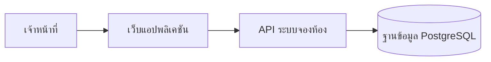
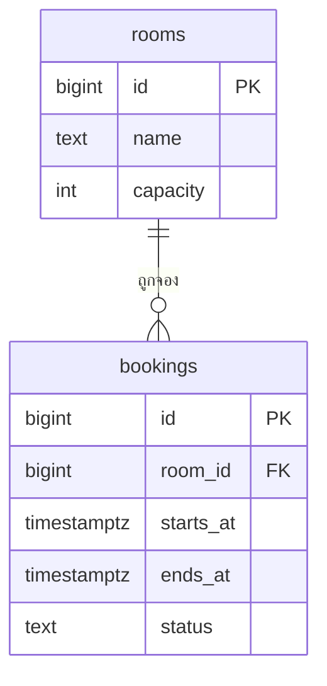

# วิธีใช้
อ่านเพื่อจับสำนวนแบบเอกสารออกแบบระบบของหน่วยงานรัฐ แล้วเขียนด้วยชื่อหน้าจอ ช่อง และฟิลด์ตามข้อเท็จจริงของโครงการนี้
ตัวอย่างเป็นระบบสมมติ "ระบบจองห้องประชุม" ภาพหน้าจอใช้บรรทัด [ภาพหน้าจอ: …] แทนจนกว่าจะมีภาพจริง

## ตัวอย่างที่ 1
### ค้นหาห้องประชุม
หน้าจอนี้ใช้สำหรับค้นหาห้องประชุมที่ว่างตามวันที่ใช้ห้องและจำนวนผู้เข้าร่วมที่ต้องการ

เจ้าหน้าที่ระบุเงื่อนไขการค้นหาดังภาพต่อไปนี้ ระบบแสดงรายการห้องที่ว่างพร้อมความจุตามตารางต่อไปนี้

[ภาพหน้าจอ: ค้นหาห้องประชุม]
ภาพ: หน้าจอค้นหาห้องประชุม

ตาราง: รายละเอียดช่องของหน้าจอค้นหาห้องประชุม
| ชื่อช่อง | คำอธิบาย |
|---|---|
| วันที่ใช้ห้อง | วันที่ต้องการใช้ห้อง เลือกจากปฏิทิน ต้องไม่เป็นวันที่ผ่านมาแล้ว |
| จำนวนผู้เข้าร่วม | จำนวนคนที่เข้าประชุม ระบบแสดงเฉพาะห้องที่จุได้ไม่น้อยกว่านี้ |
สิ่งที่ทำให้อ่านเป็นงานคนเขียน: ย่อหน้าแรกบอกว่าหน้าจอใช้ทำอะไรหนึ่งประโยค ย่อหน้าที่สองเล่าขั้นตอนหนึ่งถึงสองประโยคที่ลงท้ายด้วย ดังภาพต่อไปนี้ หรือ ตามตารางต่อไปนี้ ไม่พิมพ์เลขภาพเอง

## ตัวอย่างที่ 2
### จองห้องประชุม
หน้าจอนี้ใช้สำหรับบันทึกการจองห้องประชุมพร้อมเวลาและหัวข้อการประชุม

เจ้าหน้าที่ระบุเวลาที่ต้องการใช้ห้องดังภาพต่อไปนี้ เมื่อบันทึก ระบบตรวจสอบเวลาที่ซ้อนกันตามเงื่อนไขในตารางต่อไปนี้

[ภาพหน้าจอ: จองห้องประชุม]
ภาพ: หน้าจอจองห้องประชุม

ตาราง: รายละเอียดช่องของหน้าจอจองห้องประชุม
| ชื่อช่อง | คำอธิบาย |
|---|---|
| ห้องประชุม | ห้องที่เลือกมาจากหน้าค้นหา แก้ไขไม่ได้ |
| เวลาเริ่ม | เวลาที่เริ่มใช้ห้อง ต้องอยู่ในเวลาทำการ |
| เวลาสิ้นสุด | เวลาที่เลิกใช้ห้อง ต้องหลังเวลาเริ่ม |
สิ่งที่ทำให้อ่านเป็นงานคนเขียน: คำอธิบายช่องบอกว่ากรอกอะไรและกติกาของช่อง ไม่ซ้ำชื่อช่องเฉยๆ

## ตัวอย่างที่ 3
### bookings (การจองห้อง)
ตาราง: พจนานุกรมข้อมูลตาราง bookings
| ชื่อฟิลด์ | รายละเอียด |
|---|---|
| id | รหัสอ้างอิงการจอง ระบบสร้างให้เองและไม่ซ้ำกัน |
| room_id | FK rooms.id ห้องประชุมที่ถูกจอง |
| starts_at | วันและเวลาที่เริ่มใช้ห้อง |
| ends_at | วันและเวลาที่เลิกใช้ห้อง |
| status | สถานะการจอง ได้แก่ จองแล้ว และยกเลิกแล้ว |
สิ่งที่ทำให้อ่านเป็นงานคนเขียน: FK ขึ้นต้นด้วยตารางที่ชี้ไป ค่าที่เลือกได้เขียนครบ

## ตัวอย่างที่ 4
### Architecture Diagram
ส่วนประกอบของระบบเชื่อมต่อกัน ดังนี้

ภาพ: แผนภาพสถาปัตยกรรมของระบบ
สิ่งที่ทำให้อ่านเป็นงานคนเขียน: ประโยคนำก่อนแผนภาพ ชื่อโหนดภาษาอังกฤษ ข้อความไทยอยู่ในเครื่องหมายคำพูด

## ตัวอย่างที่ 5
### Database Diagram
ฐานข้อมูลประกอบด้วยตารางห้องประชุมและตารางการจอง โดยการจองแต่ละรายการอ้างถึงห้องที่ถูกจอง ดังภาพต่อไปนี้

ภาพ: แผนภาพฐานข้อมูล
สิ่งที่ทำให้อ่านเป็นงานคนเขียน: ประโยคนำบอกกลุ่มตารางและความสัมพันธ์หลัก แล้ววางแผนภาพ erDiagram ที่มีทุกตารางและทุก FK
