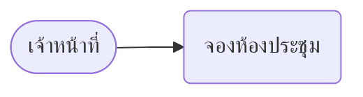

# Step C: Hand-in SRS and SDS documents (เอกสารส่งมอบ)

Two customer documents for the acceptance committee: `srs-doc.md`, then `sds-doc.md`. They are rewritten from
`srs.md`, `design.md` and `schema.sql`; nothing may be added, dropped or renamed.

## 1. Build the facts list first
Before writing, list for yourself (not in the documents):
- TOR item numbers (or numbered brief lines) and the FR ids each maps to (SRS section 8).
- Roles (SRS section 2) and subsystems (SRS section 3 modules / design section 2).
- Screens: one per user job in the FRs (list, form, detail, approval queue, report, sign-in, users, roles,
  password, audit log), each with its subsystem and field labels. If the user has a prototype or screenshots, use
  their screen names and fields instead, and put the images in `screens/` next to the documents.
- Tables and their columns from `schema.sql`.
Use these names exactly in both documents.

## 2. srs-doc.md
Level-1 headings in this order: บทนำ (หลักการและเหตุผล, วัตถุประสงค์, ขอบเขตของระบบ); ผู้ใช้งานและบทบาท;
ข้อกำหนดคุณลักษณะความต้องการของระบบ; ข้อกำหนดสำหรับผู้ใช้งาน; โครงสร้างของระบบ; ความต้องการด้านอื่น.

- Trace table: header `| ข้อ TOR | URS | SRS | FR |` (first cell `ความต้องการ` when there is no TOR). One row per TOR
  item number; cite every number and every FR id. URS cell "ผู้ใช้งานสามารถ…ได้", SRS cell "ระบบสามารถ…ได้" or
  "ระบบต้องรองรับ…". A blank first cell repeats the item above. FR ids appear only in the FR column.
- Use cases, per subsystem a `##` heading, then a use case diagram (mermaid, see below), then per use case a
  `### <ชื่อ use case>` heading directly before `| Use Case | รายละเอียด |` with rows Stakeholder Actor, Basic Flow,
  Pre-condition; right after it `| ผู้ใช้งาน | ระบบ |`, one action per row (user clicks, system shows).
- โครงสร้างของระบบ: a lead-in sentence and a mermaid diagram of the subsystems and who uses them.

## 3. sds-doc.md
Level-1 headings, in this order:
1. การออกแบบส่วนเชื่อมต่อผู้ใช้งานต้นแบบ (User Interface)
2. Architecture Diagram
3. Data Flow Diagram
4. พจนานุกรมข้อมูล (Data Dictionary)
5. Database Diagram

- Screens chapter: per subsystem a `##`, per screen a `###` heading with the screen name, a paragraph
  "หน้าจอนี้ใช้สำหรับ…" (one sentence), a paragraph of one or two sentences for the steps ending "ดังภาพต่อไปนี้"
  or "ตามตารางต่อไปนี้", then the screen image (`` when the user has one, else the
  line `[ภาพหน้าจอ: <ชื่อหน้าจอ>]` as a placeholder), a caption line `ภาพ: หน้าจอ<ชื่อหน้าจอ>`, then a caption line
  `ตาราง: รายละเอียดช่องของหน้าจอ<ชื่อหน้าจอ>` and `| ชื่อช่อง | คำอธิบาย |`, one row per field label.
- Architecture and Data Flow chapters: a lead-in sentence, one mermaid block, a caption line `ภาพ: …`, then a
  sentence per part.
- Data dictionary: per table a `## <table> (<ชื่อไทย>)` heading, a caption line `ตาราง: …`, then
  `| ชื่อฟิลด์ | รายละเอียด |`, one row per column. FK rows start "FK <table>.<column>"; list every allowed value.
- Database diagram: a sentence on the table groups and main relations, a mermaid `erDiagram` built from
  `schema.sql` (every table, every FK), a caption line `ภาพ: แผนภาพฐานข้อมูล`.

## Diagrams (mermaid)
- Node ids in English letters; Thai text only inside quotes: `user["เจ้าหน้าที่"]`.
- Use case diagram: `flowchart LR`, actors as `a1(["เจ้าหน้าที่"])`, use cases as `u1("จองห้องประชุม")`, edges
  actor → use case.
- ER: `erDiagram` with English table/column names from the schema.
- Captions: a line starting `ภาพ: ` right after a diagram or image, a line starting `ตาราง: ` right before a table.
  The converter numbers them (ภาพที่ 1, ตารางที่ 1 …); never type numbers yourself.

## Style
- Requirements: "ระบบต้องรองรับ…" or "ระบบสามารถ…ได้"; users: "ผู้ใช้งานสามารถ…ได้". A lead-in ending "ดังนี้" before
  every list.
- Restricted markdown only: # to #### headings without numbers, `- ` lists, pipe tables with a `|---|` row,
  mermaid blocks, images, caption lines. No bold, arrows, inline code, HTML, internal ids (ui-…, /api/…).
- Name a person or product only as the sources do; call the customer "หน่วยงาน". Thai, about 2,000 words per document.
- Read [examples-srs.md](examples-srs.md) and [examples-sds.md](examples-sds.md) for the tone; write with this
  project's own names, never copy the examples.

## Template (srs-doc.md, start)
```
# บทนำ
## หลักการและเหตุผล
<เหตุผลที่หน่วยงานต้องมีระบบ สองถึงสามประโยค>
## ขอบเขตของระบบ
ระบบประกอบด้วยระบบย่อย ดังนี้
- <ระบบย่อย> ใช้<ทำอะไรได้>

# ข้อกำหนดคุณลักษณะความต้องการของระบบ
ความต้องการของหน่วยงานเทียบกับความต้องการของผู้ใช้งานและของระบบ ดังนี้
ตาราง: ความต้องการของหน่วยงานเทียบกับความต้องการของผู้ใช้งานและของระบบ
| ข้อ TOR | URS | SRS | FR |
|---|---|---|---|
| 4.2.1.1 | ผู้ใช้งานสามารถ<ทำอะไร>ได้ | ระบบสามารถ<ทำอะไร>ได้ | FR-01 |
|  | ผู้ใช้งานสามารถ<ทำอะไร>ได้ | ระบบต้องรองรับ<อะไร> | FR-02 |

# ข้อกำหนดสำหรับผู้ใช้งาน
## <ระบบย่อย>
ผู้ใช้งานแต่ละบทบาทใช้งานระบบย่อยนี้ ดังภาพต่อไปนี้

ภาพ: แผนผังกรณีการใช้งานของ<ระบบย่อย>
### <ชื่อ use case>
| Use Case | รายละเอียด |
|---|---|
| Stakeholder Actor | <บทบาท> |
| Basic Flow | <ทำอะไร> |
| Pre-condition | ลงชื่อเข้าใช้งานระบบ |

| ผู้ใช้งาน | ระบบ |
|---|---|
| คลิกเมนู "<เมนู>" | แสดงหน้าจอ "<หน้าจอ>" |
```

## Checklist
- Every TOR item number and every FR id appears in the trace table.
- Every role, screen, table and column name matches the facts list; nothing added or dropped.
- SDS has the five chapters in order; every table of `schema.sql` has a dictionary section and is in the ER diagram.
- Every image/diagram has a `ภาพ:` line after it; every table that needs a caption has a `ตาราง:` line before it.
